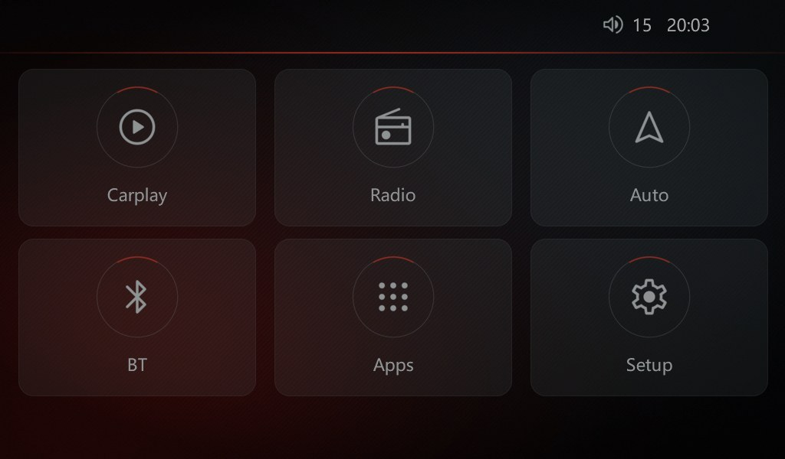
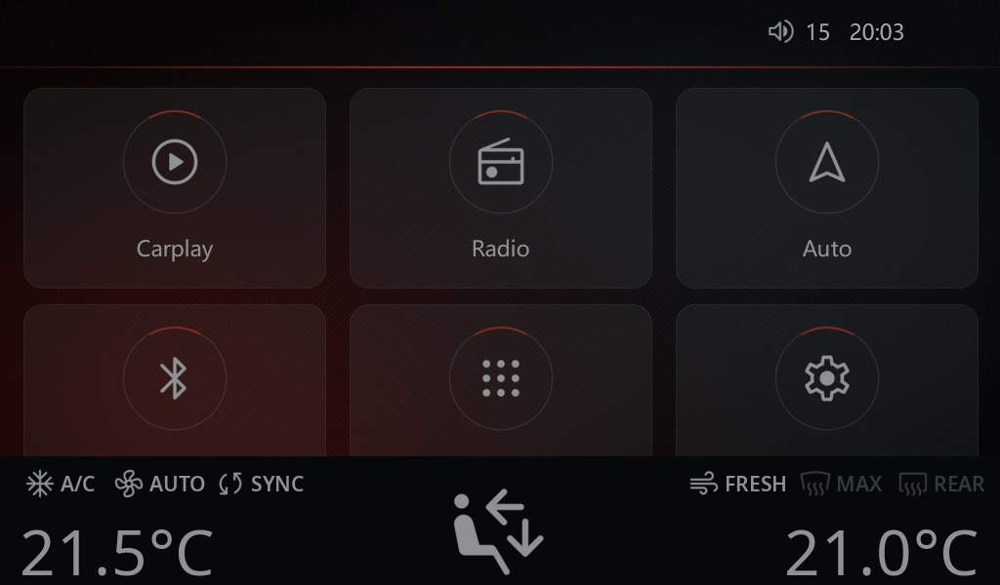
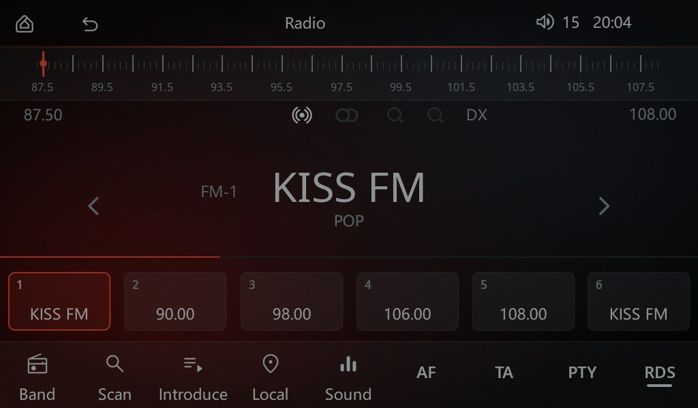
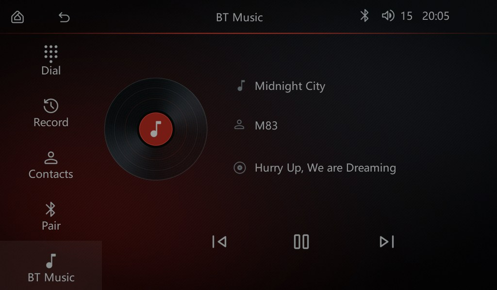

# 8369HD head unit mod

A restyle and a few functional fixes for the **8369HD**, an aftermarket car head unit (1024 x 600 screen, Allwinner
F133 / D1s, RISC-V C906, Melis RTOS) with wireless CarPlay / Android Auto and a CAN box, here fitted to a VW Passat.

Everything is built from the stock firmware update image plus this repository and installed with the unit's own USB
update; the boot loader and the kernel are never touched. **No firmware, vendor files or vendor tools are included:**
bring your own stock image ([docs/building.md](docs/building.md)).

| | |
|---|---|
|  |  |
|  |  |

## What it changes

**Look** (one design across all screens, [docs/design.md](docs/design.md)): dark glass panels over procedurally
generated wallpapers, white-grey symbols (Material Symbols), one accent colour - red, like the car's own illumination
- used only for states. Restyled: Home (all six functions on one page), Apps, Radio, Bluetooth (Dial, Talk, Music,
Contacts, Record, Pair), trip computer, climate page, volume popup, status bar, the whole Setup menu, wallpapers and
their picker.

**Function** (a small module of our own, `climabar.mod`, plus static patches of the stock app):
- climate strip: changing the climate (CAN) slides a compact strip in at the bottom for a few seconds, over any screen
  including Android Auto, instead of the stock full-screen climate page;
- open doors / boot: a car card instead of the full-screen trip computer; the seat-belt warning as a status bar symbol;
- radio: the live RDS station name in large type where the frequency was; station names learned from RDS shown on the
  preset buttons;
- Android Auto starts only from the "Auto" button (not by itself when the phone connects, which used to take the
  phone's media away from Bluetooth music), and Bluetooth music comes back after Android Auto;
- Bluetooth opens on BT Music; a short "now playing" card when the track changes.

## Repository

| Path | What |
|---|---|
| `climabar/` | the module (`src/`, C + RISC-V asm), its artwork generators and layout (`layout.json`), the init.axf patches (`tools/patch_initaxf.py`), the minimal test module |
| `home/`, `radio/`, `bt/`, `vehicle/`, `setup/` | one builder per screen group: stock `.data` UI file in, restyled file out |
| `tools/` | `build_overlay.sh` (everything), `build_image.sh` (the update image), `theme.py` (colours), recovery scripts, helpers |
| `emulator/` | the Melis emulator (git submodule, [maioance/8369hd-melis-emulator](https://github.com/maioance/8369hd-melis-emulator), a fork of [skyfortress/ekiy-melis-re](https://github.com/skyfortress/ekiy-melis-re)) |
| `docs/` | how it works, how to build, the safety rules, reverse-engineering notes |

## Quick start

```sh
git clone --recurse-submodules <this repository> && cd <it>
# put the stock image at firmware/8369HD.img and the Melis tools in tools/melis-tools/bin (docs/building.md)
tools/unpack_firmware.sh
tools/build_overlay.sh                 # all modified files -> emulator/emu/overlay
./start_emulator.sh                    # try it: http://localhost:8133
tools/build_image.sh build/8369HD.img  # the update image, verified
```

Then copy the image to a USB stick as `Update/8369HD.img` and run the update on the unit.

**Read [docs/safety.md](docs/safety.md) before changing the module or the patches.** A mistake there can leave the
unit stuck at the boot logo; recovering it needs a flash programmer.

## Documentation

- [docs/building.md](docs/building.md) - requirements, build, emulator, installing, updating
- [docs/architecture.md](docs/architecture.md) - how the unit's firmware works and where the mod plugs in
- [docs/safety.md](docs/safety.md) - rules that keep the unit booting, what not to do, recovery
- [docs/design.md](docs/design.md) - design rules, palette, components
- [docs/reverse-engineering.md](docs/reverse-engineering.md) - addresses, syscalls, protocols, settings

## Disclaimer

An independent hobby project, not affiliated with or endorsed by the head unit's maker or by any car maker; names of
cars and brands are used only to describe what the unit is fitted to. Modifying the firmware of your unit is at your
own risk: a mistake can leave it stuck at the boot logo, and recovering it may need a flash programmer
([docs/safety.md](docs/safety.md)). Keep your attention on the road.

## License

MIT ([LICENSE](LICENSE)) for this repository's code and docs. `climabar/icons_src/` holds Material Symbols (Apache
2.0, its own LICENSE). The emulator submodule is MIT (Oleksii Bondarenko and contributors). The firmware, the
`.data` UI files and all vendor artwork belong to their owners and are not part of this repository.
